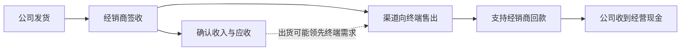

# 东阿阿胶（000423）研究报告

研究日期：2026-10-25。信息截止：2026-10-25；最新财务期：2026年前三季度，未经审计。

定价基准：2026-10-23收盘46.96元；总股本6.3983亿股；对应市值300.46亿元。三季报于10月23日盘后披露，这个收盘价尚不是市场消化新财报后的价格。

一句话研究命题：**品牌和盈利能力仍在，但公司向渠道提供的信用增长快于销售；需要验证的是增长最终能否收回现金，而不是股价有没有回撤。**

本报告结合财报精读、完整公司研究及反证检查，采用仓库已有研究报告的结构。面向学习与研究，不构成收益承诺或自动交易指令。正文不包含私人持仓股数、成本或现金信息。

---

## AI研究偏见自觉

**公司信息丰富度A级，终端经营证据B级。** 已取得2025年报、2026半年报、2025及2026三季报的完整PDF；直接核对了关键表格版面，并结合业绩说明会、独立媒体和市场报价验证。季度报表未经审计；公司公告的不同镜像只算同一底层来源，不冒充独立调查。

| 容易形成的先入判断 | 本报告的处理 |
|---|---|
| 老字号、高毛利、高分红，天然等于优质投资 | 分开评价品牌、现金兑现、再投资回报和买入价格 |
| 应收较年初暴增，就一定是重演渠道危机 | 补上去年同季及过去年度授信安排；不把季节性全部视为异常 |
| 管理层说库存安全，所以现金问题只是时间差 | 记录为公司陈述；没有库存天数、信用期限及期后回款数据就保留疑问 |
| 利润同比增长，说明所有产品需求都在增长 | 阅读产品分类，区分核心阿胶系列与其他药品保健品 |
| 股价跌了，应当止损或越跌越买 | 卖出与加仓均由价值和证据变化决定，不设回撤止损线 |

本轮没有经销商级进销存、银行流水或授信合同，也没有独立测得复购率。三个取证任务分别检查历史财务、回款反证、商业与治理，**不是每条论断三人投票的独立验证程序**。

---

## 第一步：核心数据总览

### 1. 最新财报显示：利润率尚可，现金转化变弱

金额单位：人民币亿元。同比采用2026三季报的上年同期比较口径；单季与累计严格分开。[S1][S2]

| 指标 | 2025年前三季度 | 2026年前三季度 | 变化 |
|---|---:|---:|---:|
| 营业收入 | 47.66 | 49.40 | +3.65% |
| 归母净利润 | 12.74 | 13.30 | +4.39% |
| 扣非归母净利润 | 11.55 | 12.59 | +8.97% |
| 毛利率 | 73.69% | 74.88% | +1.20个百分点 |
| 营业利润率 | 31.59% | 31.83% | +0.24个百分点 |
| 销售费用率 | 35.17% | 33.28% | -1.89个百分点 |
| 经营现金流净额 | 13.10 | 4.00 | -69.48% |
| 购建长期资产现金支出 | 0.44 | 2.81 | +540.37% |
| 经营现金流减上述资本开支 | 12.66 | 1.18 | 显著下降 |

第三季度单季收入17.85亿元、归母净利润4.69亿元，分别同比+4.05%、+2.90%；扣非归母4.39亿元、同比+19.39%。基本及稀释每股收益单季均为0.7285元，前三季度均为2.0685元。[S1]

**不能把累计经营现金流下降69.48%，写成第三季度单季下降69.48%。** 按三季累计减中期累计，2026Q3单季经营现金流为3.18亿元，上年可比约3.43亿元，同比下降7.39%。现金流同比缺口主要形成于上半年，Q3单季降幅已收窄；但Q3应收仍继续增加，不能据此认定授信风险减轻。[S1][S2][S3]

这也不是一份“只有坏消息”的财报：毛利率上升、销售费用率下降、扣非利润增长均是正面事实。问题是这份利润增长还没有同比例变成现金。

### 2. 五年财务：恢复是真实的，但不能把不同口径接成一条成长曲线

下表2021—2024采用各年原披露口径，2025采用该年报告口径。**2025同控并购导致前期重述，表内不是全程可比的有机增长序列，不据此计算五年收入CAGR。** 历史完整表及资本开支部分只有公司公告底层来源，按B级来源覆盖保留。[S4][S5]

| 年度／原披露口径 | 收入 | 归母净利润 | 扣非归母 | 经营现金流 | 购建长期资产现金支出 |
|---|---:|---:|---:|---:|---:|
| 2021 | 38.49 | 4.40 | 3.52 | 28.01 | 0.25 |
| 2022 | 40.42 | 7.80 | 7.00 | 21.45 | 0.46 |
| 2023 | 47.15 | 11.51 | 10.83 | 19.53 | 0.54 |
| 2024 | 59.21 | 15.57 | 14.42 | 21.71 | 0.97 |
| 2025 | 67.00 | 17.39 | 16.38 | 22.89 | 0.83 |

2025年7月收购东阿阿胶国际（BVI）构成同一控制下企业合并，年报第9页同时列有调整前、调整后数据。直接看宣传稿容易漏掉下面这张表：[S4]

| 比较项目 | 2024原披露 | 2024按2025年报重述 | 2025实际 | 对原数增速 | 对重述数增速 |
|---|---:|---:|---:|---:|---:|
| 营业收入 | 59.21 | 61.57 | 67.00 | +13.17% | +8.83% |
| 经营现金流 | 21.71 | 28.51 | 22.89 | +5.45% | -19.70% |

2023也被重述：收入由47.15亿元调整至58.64亿元，经营现金流由19.53亿元调整至18.14亿元。归母利润调整相对小。**宣传稿的增长数不必然是假数，但使用了不同比较基数；估值和趋势判断必须说明选择哪一列。**

### 3. 滚动十二个月估值基座

TTM定义为2025全年＋2026前三季度－2025前三季度。使用报告原数到分，不以新闻四舍五入数字计算；2025扣非前三季为11.5518亿元。2026中报还重述了上年中期比较数，单季拆算不混用旧中期口径。[S1—S4]

| 指标 | 截至2026年9月TTM |
|---|---:|
| 收入 | 68.74亿元 |
| 归母净利润 | 17.95亿元 |
| 扣非归母净利润 | 17.42亿元 |
| 经营现金流 | 13.79亿元 |
| 购建长期资产现金支出 | 3.20亿元 |
| 简化自由现金流 | 10.59亿元 |
| 归母利润口径PE | 16.74倍 |
| 扣非利润口径PE | 17.25倍 |
| PB | 3.08倍 |
| PS | 4.37倍 |
| 简化自由现金流收益率 | 3.52% |

简化自由现金流为经营现金流减购建长期资产现金支出，**未扣收购子公司款，不等于已经核准的股东可分配现金，也不等于维护性资本开支后的“所有者盈余”**。模型每股盈利统一按TTM利润除当前期末股本计算，并非将各期披露的加权平均股本EPS直接相加。当前17倍左右PE看起来比现金收益率便宜，是本报告必须解释的差异，而不是挑一个有利指标。

> 研究追问：如果完全不看股价，只看利润、应收和现金，能否确认公司的经济价值正在同步增长？目前只能确认利润增长，现金兑现仍需验证。

---

## 第二步：生意本质与经营地图

**这门生意是把原料质量、药品／健康消费品生产与品牌信任，通过药房和商业渠道转化为消费者购买；利润来自品牌溢价，现金来自消费者需求最终支持经销商回款。**

### 1. 产品不是一个同质化的“滋补大市场”

| 产品／业务 | 主要经济机制 | 不应混淆的边界 |
|---|---|---|
| 阿胶块及相关核心产品 | 品牌、质量信任、渠道覆盖、消费习惯支撑溢价 | 通用品种和品牌优势不等于不可替代专利药或无限提价权 |
| 复方阿胶浆 | 中成药产品、合规推广与医疗／零售触达 | 投资判断不等同疗效评价，不将营销材料升级为临床结论 |
| 桃花姬及便利化产品 | 使用便利、口味、即食场景和渠道营销 | 官方页面所列产品为保健食品；品牌下不同SKU的注册类别不能一概而论 |
| 皇家围场1619、壮本等 | 向鹿类、肉苁蓉及男士健康消费延伸 | 需单独验证新品复购、毛利、获客成本和投入回报 |
| 医美相关布局 | 战略探索、投资及潜在并购 | 尚不是已被证实的成熟盈利支柱 |

公司面对的不仅是其他阿胶品牌，还包括消费者有限预算下的其他健康消费选择。人口老龄化和健康意识提升是需求背景，**不是对公司收入、疗效或投资回报的自动保证**。[S3][S4][S8]

### 2. 主业与新业务的增速已经分化

| 产品分类 | 2025收入（亿元） | 2025占比 | 2026H1收入（亿元） | H1占比 | H1同比 |
|---|---:|---:|---:|---:|---:|
| 阿胶及系列产品 | 61.98 | 92.50% | 28.33 | 89.78% | -0.45% |
| 其他药品及保健品 | 3.86 | 5.76% | 2.64 | 8.38% | +86.69% |
| 毛驴养殖及驴肉／贸易 | 0.58 | 0.87% | 0.22 | 0.70% | -34.48% |
| 其他 | 0.58 | 0.87% | 0.36 | 1.14% | +16.62% |

2026H1阿胶系列毛利率77.30%，其他药品保健品62.12%。新品所在类别增速更快，但毛利更低；核心系列收入略降而毛利率改善。[S3][S4]

这意味着至少有两条不同的研究命题：一是老产品能否在销量／价格不透支渠道的情况下维持利润，二是新业务能否形成高质量增量。**不能用“新品增长快”替代“原有护城河加宽”，也不能因核心系列微降就断言全部新品都在内部分流。**

三季报没有进一步给出阿胶块、阿胶浆、桃花姬各自审计收入和渠道利润，不能把中期结构机械外推至第三季度。2025合同收入披露的境外收入约0.39亿元；“其他地区”不是全部海外。公司仍主要面对境内市场。[S4]

### 3. 毛利率高，不等于获客成本低

2026前三季度毛利率74.88%，但销售费用率33.28%，另需承担管理、研发、税金与信用成本，营业利润率为31.83%。品牌可以降低消费者疑虑，却仍要为渠道覆盖、终端触达和市场教育持续付费。[S1]

2025前五大客户销售占60.53%，最大客户占34.05%，关联方销售占9.82%。这些是客户／结算集中度，**不是消费者集中度**；没有公开核实最大客户身份，不凭匿名序号猜测。[S4]

厂家通常在交付并经客户签收后确认收入，不以终端消费者使用完毕为前提。关键机制如下：

> 研究追问：再增加一元收入，需要增加多少授信、渠道费用与资本投入？这比品牌故事的长度更接近未来回报。

---

## 第三步：护城河评估

| 来源 | 可验证基础 | 判断及反证条件 |
|---|---|---|
| 品牌与质量信任 | 阿胶系列长期为主，仍保持较高毛利 | 中等偏强；若只能靠更深折扣或更长账期维持出货，品牌变现能力需降级 |
| 渠道与规模 | 广泛商业触达、原料采购与生产体系 | 有优势；但渠道也会形成议价和资金占用，不是单向的资产 |
| 转换成本 | 有使用习惯与品牌偏好 | 有限；没有证明消费者转换成本类似企业软件或平台生态 |
| 网络效应 | 未见用户增加直接提高其他用户效用的证据 | 不作为护城河来源 |
| 工艺、批文与研发 | 质量标准、生产工艺、药品及产品注册 | 有门槛，但不能推导竞争者永远无法生产同类产品 |
| 上游原料体系 | 供应保障及质量控制 | 同时带来采购、养殖与原料价格风险，不能只计优势不计资本占用 |

**总体判断：品牌和渠道基础仍成立，但护城河的经济兑现处于复核期。** 目前不足以判定护城河已经破裂，也不足以把跨品类、医美布局预先计作护城河扩大。

同业比较应分层：福牌最接近阿胶品类竞争；同仁堂涉及多品类和零售资产；片仔癀的品种、原料约束、适应症及经营结构不同。不能把后两者的市盈率直接移植为东阿阿胶的合理倍数。本轮没有完成同口径同行TTM和历史PE序列核验，因此不宣称“处于历史最低估值”。

> 研究追问：如果未来不再提价，品牌能否靠真实复购和更好的现金回收继续创造超额收益？

---

## 第四步：现金流精读与反证

### 1. 应收增加不是2026年第一次发生

金额单位：亿元。应收为扣除坏账准备后的账面净额；经营现金流为截至该时点的累计值。[S1—S4][S6]

| 时点 | 应收账款净额 | 合同负债 | 累计经营现金流 |
|---|---:|---:|---:|
| 2025-09-30 | 5.25 | 5.22 | 13.10 |
| 2025-12-31 | 1.32 | 6.93 | 22.89 |
| 2026-03-31 | 5.07 | 4.95 | 0.29 |
| 2026-06-30 | 5.89 | 4.33 | 0.82 |
| 2026-09-30 | 8.93 | 4.32 | 4.00 |

2025三季报已明确存在年度授信及年末收回安排。其后年末应收明显回落，是季节性的支持证据；但应收下降本身不能逐笔证明全是现金回款，还要排除票据替换、退货及核销。[S2]

2026Q1销售收现同比增长49.01%、经营现金流由负转正，也反对“全年每个季度收现都在恶化”的简单叙事。[S6]

### 2. 同季比较后，警报仍然存在

- 2026年9月末应收同比增加70.11%，远高于前三季度收入增长3.65%。较年初575.32%的数字有低基数和季节性，但同季70.11%不能用同一理由全部消除。
- 同季合同负债减少17.37%。渠道对厂家的预付款支持变弱，与应收增加同时出现。
- Q3应收较6月末又增加3.04亿元，而非已开始全面收回。
- 应收、应收票据和应收款项融资合计同比仍增加63.98%；不只是报表项目之间的简单挪动。

期末应收占同期收入折算的占用天数由30.07天升至49.35天。这是**期末余额诊断值，不是标准平均应收周转天数**。用年初、期末平均余额计算，本期约28.33天；存货平均余额除同期成本、乘273天，约175.05天。季内波动、增值税和账期会影响解释，不将这些数直接当作逾期天数。[S1][S2]

2026三季报只写按约定收回，没有重复2025年明确的年末安排。不能替管理层补写“2026年底一定收齐”，也不能仅凭措辞变化认定已经展期。

### 3. 经营现金流下降9.10亿元，不能全归因于授信

下面按现金流量表做完整同比桥接。负号代表减少经营现金流，单位亿元。[S1]

| 项目 | 对经营现金流的同比影响 |
|---|---:|
| 销售商品及提供劳务收现减少 | -3.8398 |
| 采购现金支出增加 | -0.9016 |
| 职工现金支出增加 | -0.6136 |
| 税费现金支出增加 | -1.1301 |
| 其他经营现金支出增加 | -3.1890 |
| 其他经营现金流入增加 | +0.5656 |
| 税费返还增加 | +0.0079 |
| **合计净减少** | **-9.1004** |

公司将其他经营付款增加解释为营销活动及研发投入。这是付款口径，不等于损益表销售费用同比增加同样金额；结算应付款、预付及付款节奏均可能影响现金。

**分红、回购、产业园资本开支不能拿来解释经营现金流下降。** 前两项列于筹资活动，园区等购建支出列于投资活动。它们会影响总现金余额和可分配资金，但不是上述经营现金桥的组成部分。

### 4. 并购和存量坏账能解释多少

2026H1两家吉林标的在购买日合并披露的应收款项合计只有27.41万元，无法解释中期数亿元的应收增加；但Q3新子公司后续销售形成的应收未单独披露，不能把全部增量精确归属于原有阿胶经销渠道。[S3]

中期应收单项全额计提的存量约2.86亿元，期初已有相同金额。不能把历史坏账重新包装为2026突然爆发的新坏账。另一方面，一年以内账龄也不等于未逾期，必须知道合同信用期限。

公司存货较年初下降9.55%，不代表经销商渠道库存同步下降。厂家发货可以同时降低厂家库存、增加经销商库存；缺少终端进销存，无法直接下结论。

### 5. 三个竞争性解释

| 待检验解释 | 支持证据 | 反对证据／缺口 | 本轮判断 |
|---|---|---|---|
| 全是正常季节性授信 | 过去有年内授信；2025年末应收回落；Q3单季现金流降幅远小于累计 | 同季应收仍快增、预收减少；未披露2026授信到期结构与期后回款率 | 只能解释一部分，不能宣布问题已解除 |
| 已重演2019渠道危机 | 厂家出货和终端需求可能脱节；信用扩张值得警惕 | 未取得独立渠道库存、价格倒挂、退货或逾期证据；主业利润率仍改善 | 证据不足，不将怀疑写成事实 |
| 增长与市场投入过渡期，现金暂时落后 | 新品、营销、研发、采购付款增加；资本结构仍有缓冲 | 新品回报和授信质量尚未证实，投入也可能长期化 | 当前最需跟踪的中间情形 |

**反证结论：不是“已经证明压货”，而是“利润增长尚未充分通过现金检验”。** 这会削弱高现金兑现的投资假设，但还不足以独自证明企业价值永久损失。

> 研究追问：如果年末应收降低，究竟是收回现金、换成票据、退货冲销还是核销？只看一个期末余额仍然不够。

---

## 第五步：资产负债表、管理层与资本配置

### 1. 轻有息负债是真的，“72亿元都可立即分掉”则不是

截至2026-09-30，单位亿元。[S1][S3]

| 项目 | 金额 | 解释 |
|---|---:|---|
| 货币资金 | 36.71 | 含不属于现金等价物的部分 |
| 交易性金融资产 | 36.11 | 不自动等于无风险、即时可用现金 |
| 两项合计 | 72.82 | 广义流动金融资产参考，不是全部冗余现金 |
| 现金及现金等价物 | 26.43 | 现金流量表期末口径，不能与货币资金再相加 |
| 银行短期／长期借款 | 无列示余额 | 不是“没有任何负债” |
| 流动及非流动租赁负债 | 0.61 | 已纳入下述广义净现金计算 |
| 广义净现金参考 | 72.21 | 货币资金＋交易性资产－银行借款－租赁负债 |
| 总负债 | 25.58 | 含经营性、租赁及其他负债，不全部当作计息融资 |

广义净现金参考约占市值24.03%，提供财务缓冲。但中报已显示定存、保证金等与现金等价物的差别；三季报附注不足以逐项确定最新受限资金和全部理财流动性。还需为营运、采购及项目留存资金。因此，本报告估值不另加72.21亿元现金，避免把含金融收益的权益利润和全部金融资产重复计算。

商誉约占总资产0.19%，无形资产约4.00%。当前商誉规模不是首要风险；未来跨品类并购的价格和回报，比当前小额商誉的同比增幅更重要。

### 2. 管理层是集团经理人体系，不是创始人控股模式

截至最近法定披露，程杰为董事长，孙金妮为董事、总裁及法定代表人，丁红岩为副董事长。不能把“公司负责人”误写成董事长。[S4][S9]

华润东阿阿胶有限公司与华润医药投资有限公司两名一致行动股东合计持有2.1700亿股、占33.91%。这是上市公司层面的合计持股，不等于华润医药对整个上市公司的最终经济权益比例。[S1]

股权激励已经实施，但管理层持股规模不能按创始人式重大财富绑定理解。本轮未完成二次修订考核条款的独立核验，不沿用旧草案的ROE或增长考核数字。

### 3. 资本配置必须把分红和扩张放在同一张表里

| 决策 | 已确认事实 | 投资者应如何评价 |
|---|---|---|
| 分红 | 2025年度剩余权益分派、2026中期分派均已实施 | 是真实股东回报；预案与实施基数有差异，不能重复计算，也不能保证未来派息 |
| 市价回购注销 | 415万股、约2亿元回购已在2026年6月完成注销 | 减少股数，盈利不变时增厚EPS；不等于增加每股账面净资产。是否创造价值取决于回购价相对内在价值；资金支出跨年度 |
| 新一批拟注销 | 10月公告拟注销剩余回购股份38.5869万股 | 截止日尚不是已完成事项，不从本报告股本中提前扣除 |
| 产业园 | 拟投资14.85亿元健康消费品产业园，2026年2月获批 | 总预算不等于当期全部支出；维护性和扩张性开支需分开 |
| 并购与新业务 | 向药品、健康消费品及医美相关机会探索 | 品牌协同只是起点，需验证投入资本回报，不能预先赋予成功概率100% |

2026前三季度购建长期资产支出2.81亿元，明显高于2025全年的0.83亿元；其中包含扩张项目，并非全部维持现有业务所必需。没有可靠拆分前，既不能把它全算维护性成本，也不能为了提高估值全部剔除。[S1][S4]

### 4. 管理层答复的可验证程度

| 陈述 | 来源及已知情况 | 尚缺证据 |
|---|---|---|
| 渠道库存整体安全 | 2026H1业绩说明会，公司自述 | 未给库存天数、分渠道进销存及独立终端核验 |
| 山姆渠道动销和复购良好 | 中期说明会披露约7000万元渠道收入 | 缺复购率、分母、毛利与同店口径；不能当成终端GMV |
| 授信为阶段性使用、按约定收回 | 中报及三季报解释 | 缺本轮额度、期限分布、逾期率和期后回收率 |

这些表述不等于不诚信，但量化程度不足，尚不能解除现金质量疑问。没有取得单独的管理层致股东信，也没有季度公布后的完整说明会，不模拟其未回答的问题。

> 研究追问：如果同时承诺高分红、更多品类和更大项目，资金从哪里来，增量资本又凭什么获得高回报？

---

## 第六步：行业趋势与可能的失败路径

长期健康需求、便利化消费、药品渠道和品牌信任可以支持生意延续；但阿胶不属于需求自动指数增长的技术平台。新消费场景是否形成高复购，必须通过真实购买和单位经济性检验，而不是把所有健康产业规模算作公司的可服务市场。

2019的历史教训是渠道库存和终端消耗不能无限背离，而不是“2026出现应收就必然重演2019”。当前没有取得足够证据证明同等规模的库存危机已经发生。[S10]

| 失败路径 | 当前证据强弱 | 可能的价值影响 | 应观察什么 |
|---|---|---|---|
| 终端增长不足，信用延长支撑出货 | 中等预警，未证实压货 | 收入质量、坏账与利润率同时承压 | 到期回款、同季应收与票据、退货、渠道动销 |
| 新品扩张吞噬原有高回报 | 投入与分类收入已见，最终回报未知 | 增长还在，但可分配现金减少 | 新品毛利、获客费用、复购、园区利用率 |
| 品牌溢价弱化 | 暂无足够独立价格／销量样本 | 稳态利润率及合理估值下降 | 同规格价格、促销强度、净增消费者 |
| 重大质量／监管冲击 | 无本轮事件概率依据，未纳入数值模型 | 可能造成非线性损失 | 合规公告、监管措施、产品召回等正式披露 |
| 重大并购失败 | 战略存在，未对未宣布交易建模 | 现金被消耗、资本回报永久下降 | 对价、盈利承诺、关联关系、后续现金回报 |

不为上述路径编造客观概率；下节情景权重只是估值判断，不是统计预测。

> 研究追问：真正可能错在哪里？既可能把季节性授信当成危机，也可能把过去能收回误当成今年一定能收回。

---

## 第七步：估值与安全边际

### 1. 先定起点，不把账面利润直接等于现金

估值以TTM扣非归母17.42亿元、每股2.7221元为盈利起点。它剔除了已披露非经常性项目，但仍不是经过完整经济调整的所有者盈余；更没有证明现金回收已经正常化。

基础读数是：归母PE16.74倍、扣非PE17.25倍，而TTM简化自由现金流收益率只有3.52%。因此现价可以被“利润稳定＋现金恢复”解释，却不支持无条件认定明显低估。

### 2. 三年三情景：回答当前价格贵不贵

未来三年增长率和退出PE均为研究假设，非管理层指引。悲观假设信用／需求问题导致盈利缓慢收缩；基准是成熟品牌维持低个位数增长；乐观要求核心需求、新品和回款共同改善。12／16／20倍仅用于有限期市场定价情景，**不作为十年后的永续终值来源**。

| 情景 | EPS年增速假设 | 三年后PE假设 | 三年后EPS | 三年后价格 | 对46.96元价格变化 | 含假设分红的年化IRR |
|---|---:|---:|---:|---:|---:|---:|
| 悲观 | -5% | 12倍 | 2.3339元 | 28.01元 | -40.36% | -11.47% |
| 基准 | +5% | 16倍 | 3.1512元 | 50.42元 | +7.37% | +6.76% |
| 乐观 | +10% | 20倍 | 3.6231元 | 72.46元 | +54.31% | +19.81% |

假设每年分出当年模型利润的70%，不考虑税、交易成本和股本变化；分别对应三年累计每股分红5.16／6.31／6.94元。分红路径不是承诺。三年基准的价格50.42元是**未来值**，不是今日公允价值；连同模型分红按8%折现，今日价值约45.43元。

三年判断：**现价接近基准价值，安全边际不厚；乐观收益依赖经营改善，而不是仅靠估值便宜。**

### 3. 十年模型：参数必须显式，而不是靠调折现率制造低估

全程人民币口径，基准资本成本$r=8\%$，稳态增量$ROIC=20\%$，永续增长悲观／基准／乐观为0%／1.5%／2%。未来十年的利润增长分别为-3%／+5%／+10%，不是永续增长率。

| 参数 | 采用理由与边界 |
|---|---|
| 8%资本成本 | 采用仓库人民币基准；可理解为长期归一化无风险回报假设2.5%＋风险补偿假设5.5%，不是本轮估计的当日CAPM |
| 20%稳态增量ROIC | 品牌有优势，但不假设新园区、新品和并购能永远复制原有品牌回报；这是判断值，不是实测存量ROIC |
| 永续增长0%／1.5%／2% | 长期成熟消费业务，基准低于仓库人民币上限；不把老龄化或新品愿景直接推到永续高增长 |
| 年度派息率70% | 有真实分红历史，但现金质量和扩张支出约束未来；降低于无限制全额派息假设 |
| 情景权重30%／50%／20% | 有意保留回款失速的下行情景；主观权重，不是事件的可测客观概率 |

工具的无风险参考值硬编码为仓库2026年8月口径1.7%。本次口径检查沿用该**历史工具参考值**，不称其为10月25日实时国债收益率，也不因此改变8%的估值要求。首次将归一化2.5%作为工具参考传入被拒绝后，明确拆分了“长期估值假设”和“工具历史校验参考”，没有调整公共工具或提高永续增速来迎合买入结论。

十年退出倍数仅由永续增长模型产生：

$$
PE_{终值}=\frac{1-g/ROIC}{r-g}
$$

| 情景 | 第十年利润（亿元） | 永续g | r-g | 退出PE（对应下一年利润） |
|---|---:|---:|---:|---:|
| 悲观 | 12.84 | 0% | 8.0个百分点 | 12.50倍 |
| 基准 | 28.37 | 1.5% | 6.5个百分点 | 14.23倍 |
| 乐观 | 45.17 | 2% | 6.0个百分点 | 15.00倍 |

基准三档均满足分母至少5个百分点。乐观前十年增长10%且派息70%，隐含较高的增长期资本效率，因此乐观不是基准；稳态ROIC也不等于增长期每年的实际回报。

### 4. 完整分红现金流折现，与工具近似IRR分开列示

完整现金流模型逐年计算利润及70%分红，在第十年末加入退出价值。永续倍数对应下一期利润，因此第十年末终值使用“第十年利润×(1+g)×退出PE”，以第十一年利润匹配永续现金流，再折现求现值与IRR。**不另加现有现金，不假设未来有额外特别分红，也不另外估值未分配现金的累积。** 因而这是明确边界下的全权益模型，不是唯一正确价值。

| 情景 | 今日每股折现价值 | 完整分红现金流IRR | 工具近似年化回报 |
|---|---:|---:|---:|
| 悲观 | 22.69元 | -1.56% | -2.02% |
| 基准 | 46.04元 | +7.74% | +7.06% |
| 乐观 | 71.14元 | +13.38% | +12.53% |
| 概率加权 | 44.05元 | +6.08% | +5.43% |

工具近似回报是资本利得几何年化加固定初始股息率约4.06%，且仓库工具直接以第十年利润乘退出倍数，不补下一期的(1+g)。它不是逐年分红现金流的严格IRR。本报告完整现金流列已纠正终值时点，工具列保留原实现用于兼容仓库压力测试；两种方法不互换。概率加权IRR也是各情景IRR的加权值，不是保证能实现的单一路径收益率。

基准现值中约64.44%来自终值，意味着即使公式精确，主要不确定性仍在长久期假设。反向计算：在相同8%资本成本、70%派息、1.5%永续增长和20%稳态ROIC下，46.96元约隐含未来十年利润年增5.25%。这不是夸张的高增长定价，但要求现金回收与成熟品牌增长能够持续兑现。

### 5. r±2个百分点敏感性与翻转

以下使用仓库工具近似回报口径，其他参数固定，不随$r$改变$g$。

| r | 概率加权工具近似IRR | 是否覆盖r | 解释 |
|---|---:|---|---|
| 6% | +9.08% | 工具显示通过 | 数值敏感性参考；基准／乐观分母低于5个百分点，不能据此下单 |
| 8% | +5.43% | 未通过 | 人民币基准 |
| 10% | +2.83% | 未通过 | 超出仓库人民币合理区间，仅供参考 |

为避免仅依赖分母过窄的6%档，再在有效区间复核：

| r | 概率加权工具近似IRR | 是否覆盖r |
|---|---:|---|
| 7% | +7.07% | 勉强通过 |
| 8% | +5.43% | 未通过 |
| 9% | +4.04% | 未通过 |

**在币种合理、分母有效的区间内，结论仍会随折现率翻转。** 7%的通过幅度很小，不支持把模型结果当成重仓的强证据；8%未通过也不自动意味着应该卖出。

### 6. 估值分歧对账

| 视角 | 得到的结论 | 应如何使用 |
|---|---|---|
| 三年定价 | 基准现值约45.43元，接近46.96元 | 当前不具备明显安全边际 |
| 十年完整现金流 | 基准46.04元，加权44.05元 | 大致支持“合理附近、需要现金改善”，不是精确目标价 |
| 十年仓位压力测试 | 加权近似5.43%未覆盖8%，并随r翻转 | 不宜据此扩大到核心重仓；不能单独否决持有 |
| 生意与资产负债表 | 品牌仍在、利润率未崩、轻有息负债 | 支持给经营验证时间，但不替代价格纪律 |
| 最新经营证据 | 同季应收增长显著快于收入 | 提高新增资金的证据门槛 |

模型没有产生“大幅低估”的结论，但也没有证明业务永久损坏。**现有持有人可以持有并跟踪，不因账面回撤机械卖出；新增资金需要更好的价格或更强的回款证据。**

> 研究追问：如果资本成本错一个百分点，策略就翻转，能否据此证明应当重仓？不能；还需要更宽的安全边际和更硬的经营证据。

---

## 第八步：综合决策与行动清单

### 1. 六个维度并列判断

| 维度 | 判断 | 置信度 |
|---|---|---|
| 生意质量 | 品牌溢价与成熟产品基础存在，利润现金兑现转弱 | 中 |
| 护城河 | 品牌和渠道有基础，尚无证据证明破裂；新品不预授护城河 | 中 |
| 管理层 | 分红、回购已发生；授信披露和新投资回报需更透明 | 中 |
| 最大风险 | 终端需求弱于出货、信用扩张变为永久资金占用 | 中；尚缺独立渠道证据 |
| 行业趋势 | 成熟健康消费需求延续，但不自动保证高成长 | 中低 |
| 估值 | 三年合理附近；十年压力未覆盖基准r且敏感性翻转 | 模型计算高，参数判断中低 |

估值不是唯一裁决。十年压力测试用于约束加大仓位，不以单个回报门槛替代对企业的判断。

### 2. 当前策略与价格区间

| 情况 | 行动倾向 | 前提 |
|---|---|---|
| 空仓者，现价约46.96元 | 暂不急于新建仓 | 与基准价值接近，先等待回款或更明显折价 |
| 已有中等仓位 | 持有观察，暂不因下跌而自动补仓 | 买入逻辑尚未被证明破裂；资金期限允许持续跟踪 |
| 35元附近及以下 | 提升为分批研究／建仓候选区 | 约对应模型加权价值20%折价，但必须确认价值未同步下降 |
| 35—40元 | 可讨论小规模、分阶段配置 | 应收回收、逾期和终端数据没有继续恶化，不以价格单独触发 |
| 40—50元 | 更接近合理定价区 | 主要赚经营改善与分红，不宜依赖大幅估值扩张 |
| 55元以上但盈利假设未上修 | 重新比较持有回报和其他机会，考虑是否减配 | 不是固定止盈线；若基本面价值上修，原区间需重算 |

35元附近来自44.05元模型加权价值的约20%折价，精确计算为35.24元；其他区间为围绕基准价值的研究行动带，不是市场预测。**买入线、减配观察线都服从企业价值变化，不是技术止损。**

### 3. 哪些证据会改变结论

**支持继续持有或提高新增资金优先级：**

- 对已到期授信披露实际回款，现金流改善且应收与票据合计占用下降，不只是重分类。
- 年末回款体现正常季节性，且没有同步扩大退货、展期和新增坏账。
- 核心阿胶系列需求企稳，新品在可验证复购、毛利和获客成本上成立。
- 产业园与并购投入形成增量现金回报，不长期依赖现有现金储备填补。

**支持降低价值判断、重新考虑减持：**

- 到约定期限仍无法回款，反复展期、逾期或坏账增加，同时终端动销走弱。
- 多个可比期间应收增长持续显著超过收入、预收继续下降，且有进一步证据表明新增收入主要依赖持续放宽信用条件。
- 核心品牌价格与销量同时受损，正常化利润预期需要持续下修。
- 重大不利资本配置、质量或治理事件造成可验证的永久价值损失。

这些是复核条件，不是单指标自动交易规则。下一份最重要材料是授信到期后的回款披露及2026年报，而不只是下一次股价涨跌。

### 4. 这份财报改变了什么

- **相对市场一致预期：** 未取得发布前可验证的一致预期，不冒称超预期或低于市场预期。
- **相对研究中的投资假设：** 若原逻辑是“强品牌＋强现金回收＋持续分红”，本期对现金回收环节构成削弱，尚未证明整体逻辑破裂。没有读取用户原始买入记录，不把该假设冒充用户本人论文。
- **最应做的一件事：** 把授信期限、期后回款和终端库存列为第一研究优先级；不是按回撤设卖出线。

四位投资者相关问题仅作为研究框架，不代表他们对东阿阿胶的真实评价。本轮未取得足够公司相关原始立场，**不模拟巴菲特、芒格、段永平或李录为本报告结论背书**。

---

## AI分析置信度、限制与审计

| 层次 | 置信度 | 边界 |
|---|---|---|
| 披露财务数、同季比较、现金桥、股本和计算 | 较高 | 已读原始PDF，关键表格视觉复核；季度未经审计，审计数字不等于审计真实终端需求 |
| 护城河、管理层与正常化盈利 | 中等 | 有公开经营证据，没有渠道和管理层访谈 |
| 长期增速、派息率、估值与情景权重 | 中低 | 判断性输入，已给敏感性和反向估值，不是预测 |
| 实际投资确定性 | 中等偏谨慎 | 现金回收关键问题尚待后续证据，模型对资本成本敏感 |

明确限制：

1. 2021—2024全部历史字段、精确capex、若干现金附注、客户集中度和地区表仅有公司披露底层来源；不能宣称全表独立双源核实。
2. 2025年、2026中报的同控重述使部分季度比较口径不完全一致；正文不混拼原披露增长线，TTM及单季现金采用明确列示口径。
3. 没有独立终端库存、逐笔授信、回款与退货资料；媒体专家意见不是经营事实。
4. 没有精确维护性capex拆分；交易性资产不能全部当现金，广义净现金不全为可分配资本。
5. 没有完成同口径同行估值和历史PE分位，不以未经核验的“历史低估”支持结论。
6. 重大质量／监管事件和重大并购失败没有量化纳入情景概率；三情景不覆盖全部尾部风险。
7. 未对股息税、交易成本、未来股本变化、未分配现金累积及特别分红单独建模。派息率与增长必须未来由实际现金支撑。
8. 本轮不是逐条论断三人票决，也不是独立财务审计。

### 关键数据交叉验证记录

| 数据点 | 公司原件／计算主值 | 第二来源 | 差异处理 |
|---|---|---|---|
| 10月23日收盘价 | 46.96元，腾讯行情 | 新浪行情、证券之星当日报价 | 一致；为披露前收盘 |
| 总股本 | 639,826,824股，Q3原件 | 腾讯行情股本字段 | 一致；拟注销部分不提前扣除 |
| 2025收入 | 67.0047亿元 | 新华社67亿元 | 四舍五入差异，低于1% |
| 2025归母 | 17.3874亿元 | 新华社17.39亿元 | 四舍五入差异，低于1% |
| 2025经营现金流 | 22.8921亿元 | 新华社22.89亿元 | 金额一致；同比需另外区分重述口径 |
| 2026Q3应收 | 8.9306亿元 | 蓝鲸8.93亿元 | 四舍五入差异，低于1% |
| 2026前三季经营现金流 | 3.9970亿元 | 观点网4.00亿元 | 四舍五入差异，低于1% |
| 控股一致行动持股 | 216,996,337股／33.91% | 华润港交所公告列示直接及间接持股 | 控制与最终经济权益不混用；百分比不直接机械相加 |
| 市值与TTM估值 | 股价×股本、三表到分输入重算 | 行情市值及工具算式 | 不以工具中位数替代公司原值 |

输入、计算程序和输出分别见 [inputs.json](research-20261025/inputs.json)、[calculate.py](research-20261025/calculate.py)、[results.json](research-20261025/results.json)。金融工具原始输出见 [financial-rigor.txt](research-20261025/financial-rigor.txt)，终值口径和翻转检查见 [terminal-audit.txt](research-20261025/terminal-audit.txt)、[2个百分点敏感性](research-20261025/terminal-flip-2pp.txt)、[1个百分点敏感性](research-20261025/terminal-flip-1pp.txt)。最终抽检记录见 [audit-verdict.txt](research-20261025/audit-verdict.txt)。

财务金额的程序核验、情景算术核验与投资命题验证是三件事；工具通过不代表所有未来结论已经得到证实。

---

## 数据来源

- **S1**：[2026年第三季度报告完整PDF](https://file.finance.sina.com.cn/211.154.219.97:9494/MRGG/CNSESZ_STOCK/2026/2026-10/2026-10-24/12656258.PDF)，公司原件镜像，2026-10-24；重点第4—6、8—14页。[可读正文镜像](https://cfi.net.cn/p20261023000567.html)。
- **S2**：[2025年第三季度报告完整PDF](https://file.finance.sina.com.cn/211.154.219.97:9494/MRGG/CNSESZ_STOCK/2025/2025-10/2025-10-25/11531672.PDF)，2025-10-25；同季应收、授信、利润及现金流比较。
- **S3**：[2026年半年度报告完整PDF](https://file.finance.sina.com.cn/211.154.219.97:9494/MRGG/CNSESZ_STOCK/2026/2026-8/2026-08-21/12509887.PDF)，2026-08-21；产品第14页及现金、授信、并购附注。[正文镜像](https://money.finance.sina.com.cn/corp/view/vCB_AllBulletinDetail.php?stockid=000423&id=12509887)。
- **S4**：[2025年年度报告完整PDF](https://file.finance.sina.com.cn/211.154.219.97:9494/MRGG/CNSESZ_STOCK/2026/2026-3/2026-03-20/12005420.PDF)，2026-03-20；重述第9页、产品第16—17页及治理、现金和期后项目附注。[正文镜像](https://money.finance.sina.com.cn/corp/view/vCB_AllBulletinDetail.php?stockid=000423&id=12005420)。
- **S5**：历史公司年报镜像：[2021](https://money.finance.sina.com.cn/corp/view/vCB_AllBulletinDetail.php?stockid=000423&id=7916549)、[2022](https://vip.stock.finance.sina.com.cn/corp/view/vCB_AllBulletinDetail.php?stockid=000423&id=8910700)、[2023](https://money.finance.sina.com.cn/corp/view/vCB_AllBulletinDetail.php?stockid=000423&id=9889311)、[2024](https://vip.stock.finance.sina.com.cn/corp/view/vCB_AllBulletinDetail.php?stockid=000423&id=10789333)。
- **S6**：[2026年第一季度报告](https://disc.static.szse.cn/download/disc/disk03/finalpage/2026-04-25/48c2cb5a-dc27-4e32-88d3-de075f864d3a.PDF)，2026-04-25。
- **S7**：[2026H1业绩说明会记录](https://file.finance.sina.com.cn/211.154.219.97:9494/MRGG/CNSESZ_STOCK/2026/2026-8/2026-08-23/12521303.PDF)，会议2026-08-21、披露8月23日；[Q1说明会](https://file.finance.sina.com.cn/211.154.219.97:9494/MRGG/CNSESZ_STOCK/2026/2026-4/2026-04-26/12206081.PDF)，2026-04-26披露。公司自述，不当独立终端调查。
- **S8**：官方产品资料：[复方阿胶浆](https://www.dongeejiao.com/hxPro/2023-04-20/324191.html)、[桃花姬阿胶糕](https://www.dongeejiao.com/hxPro/2023-04-20/324189.html)，访问于2026-10-25；只支持对应页面产品类别，不推广至全部SKU。
- **S9**：[上海证券报2026-10-24法定信披](https://paper.cnstock.com/html/2026-10/24/content_2280875.htm)；[华润医药港交所2026-10-23披露](https://www1.hkexnews.hk/listedco/listconews/sehk/2026/1023/2026102300999_c.pdf)。
- **S10**：[财联社历史渠道调研，2024-09-25](https://m.cls.cn/detail/1809062)；[经济观察网，2020-03-26](http://www.eeo.com.cn/2020/0326/379406.shtml)。仅用于历史机制对照，不冒充2026终端数据。
- **S11**：独立财经报道：[蓝鲸，2026-10-23](https://www.lanjinger.com/d/1792759902336668727)、[北京商报，2026-10-23](https://finance.eastmoney.com/a/202610233906399578.html)、[观点网，2026-10-23](https://www.guandian.cn/article/20261023/617323.html)、[新京报，2026-08-21](https://m.bjnews.com.cn/detail/1787303674169537.html)。媒体评论与公司披露数字分开使用。
- **S12**：[新华网2025年报报道，2026-03-25](https://www.news.cn/health/20260325/7d296d607854459cb7e599e7a148c0ba/c.html)；[国泰海通首次覆盖摘要，2026-04-05](https://news.futunn.com/post/71291022/dong-e-ejiao-000423-initial-coverage-report-a-leader-in)。用于金额交叉核验；宣传性语句及预测不直接转作结论。
- **S13**：[腾讯行情](https://qt.gtimg.cn/q=sz000423)、[新浪行情](https://hq.sinajs.cn/list=sz000423)、[证券之星10月23日报价及三季报摘要](https://m.sohu.com/a/1091886833_115377)，均对应2026-10-23收盘。接口会更新，本文固定采用上述日期。

补充来源状态、原件哈希与核验范围见 [sources.md](research-20261025/sources.md)。
